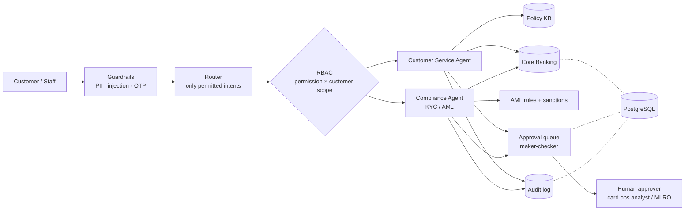

# Banking AI: Customer Service + KYC/AML Agents

A governed multi-agent assistant for retail banking with two specialist agents:

- **Customer Service agent**: balances, transactions, card freeze, disputes, customer-reported unauthorised transactions, KYC status and document guidance, and policy Q&A (RAG with citations).
- **Compliance agent (KYC/AML)**: transaction monitoring (structuring, rapid in/out movement, high-risk geography), fuzzy sanctions screening, KYC checks, and SAR drafts that only the MLRO can file.

It runs **fully offline**, with deterministic routing and templated answers. Add an `OPENAI_API_KEY` and an LLM takes over intent routing and answer phrasing, while every fact and decision still comes from deterministic tools. **There are no ML models to train** and no scikit-learn or scipy.

**Testing step by step in VS Code:** see [TESTING.md](TESTING.md).

## Use cases and where they live

| Use case | Where | Technique |
|---|---|---|
| Virtual banking assistant | `bank/agents.py` | Router, then the specialist agent, then tools |
| Card misuse reported by the customer | `bank/agents.py` (`_report_fraud`) | Instant temporary freeze + dispute; permanent block goes to a human with plain-language red flags |
| KYC status and documents | `bank/agents.py` (`_kyc_status`), `kb/kyc_aml.md` | Customer sees status + what to submit; compliance staff also see screening |
| AML transaction monitoring | `bank/aml.py` | Structuring, rapid in/out movement, high-risk geography rules |
| Sanctions screening | `bank/aml.py` | Fuzzy name matching |
| Policy Q&A (RAG) | `bank/kb.py`, `kb/*.md` | Section chunking + TF-IDF retrieval (pure Python) with source citations |
| Governance | `bank/guardrails.py`, `bank/audit.py` | PII masking, injection and OTP guard, maker-checker approvals, append-only audit log |
| Access control | `bank/rbac.py`, `db/rbac_seed.sql` | Database-driven RBAC: scoped permissions, segregation of duties |
| Data platform | `db/schema.sql`, `bank/db.py`, `bank/store.py` | PostgreSQL: constraints, indexes, persisted approvals, audit trigger |

## Architecture



**Design rules that matter in banking**

- **The LLM never decides.** It classifies intent and phrases answers from tool output only.
- **Reversible actions are automatic; irreversible ones need a human.**
  - A temporary card freeze happens instantly.
  - A permanent card block needs a card-operations analyst.
  - Filing a SAR needs the MLRO.
- **Maker-checker.** The agent that proposes an action, and the person who asked for it, can never approve it.
- **No tipping-off.** Customers and front-line support staff never see sanctions screening or AML results; only compliance roles do.
- **Every request is audited**, with PII masked before it reaches the database. The `audit_log` table rejects UPDATE and DELETE.

## Run it

### Option A: Python on Windows/macOS/Linux
```powershell
python -m venv .venv
.\.venv\Scripts\Activate.ps1          # macOS/Linux: source .venv/bin/activate
python -m pip install -r requirements.txt
Copy-Item .env.example .env           # macOS/Linux: cp .env.example .env
docker compose up -d                  # PostgreSQL 16 on localhost:5432
python data/generate.py               # synthetic bank: 500 customers, ~36k transactions, sanctions list
python -m db.load                     # create the schema and load the data (re-run any time to reset)
python demo.py                        # end-to-end scenarios across both agents and all roles
python -m pytest -v                   # 28 behavioural tests (resets the database first)
python -m uvicorn api:app --reload    # REST API, then open http://127.0.0.1:8000/docs
```

### Option B: everything in Docker
Use this if Windows Smart App Control blocks Python packages.
```powershell
docker compose --profile app build
docker compose run --rm app python data/generate.py
docker compose run --rm app python -m db.load
docker compose run --rm app python demo.py
docker compose run --rm app python -m pytest -v
docker compose run --rm --service-ports app python -m uvicorn api:app --host 0.0.0.0 --port 8000
```
Then open **http://127.0.0.1:8000/docs**. Don't use `0.0.0.0` in the browser.

## Access control (RBAC)

Callers identify themselves with the `X-User` header. Roles and permissions are looked up in PostgreSQL, never taken from the request.

| Role | Users | Can | Approves |
|---|---|---|---|
| `customer` | `C0001` … `C0500` | Own balance, transactions, card freeze, disputes, report misuse, own KYC status; policy Q&A | — |
| `support_agent` | `support_01` | Any customer's balance, transactions, card freeze, KYC status (without screening) | — |
| `fraud_analyst` (card operations) | `analyst_01`, `analyst_02` | Read transactions | Permanent card blocks |
| `compliance_officer` | `cmp_02`, `cmp_03` | AML reviews, KYC status with sanctions screening | — |
| `mlro` | `mlro_01`, `mlro_02` | AML reviews, KYC status with screening | SAR filings |
| `auditor` | `auditor_01` | Read the audit log | — |
| `rbac_admin` | `admin_01` | Create users, grant and revoke roles | — (no business permissions) |

Rules that always hold:

- **Deny by default.** Unknown, deactivated or role-less users can do nothing.
- **Scoped data.** `:own` permissions reach only the user's own customer record; `:any` reaches every customer.
- **The router never sees forbidden intents.** The orchestrator also re-checks whichever intent it picks.
- **Segregation of duties.** A database trigger refuses conflicting roles, for example admin + MLRO or auditor + compliance.
- **No self-escalation.** Every grant, revoke and denial is audited.

## Planted test data (synthetic)

| Customer | What's planted | Expected result |
|---|---|---|
| C0006 | 5 cash deposits just under ₹50,000 in 7 days | `STRUCTURING`, SAR draft for the MLRO |
| C0009 | ₹9 lakh in, ~87% out to the UAE within 24h | `RAPID_MOVEMENT` |
| C0018 | Name "Viktor Draganoff" vs listed "Viktor Draganov" | `SANCTIONS_SCREENING`; visible only to compliance |
| C0022 | Transfer to Iran | `HIGH_RISK_GEOGRAPHY` |
| C0177 | Foreign jewellery purchase T0013255 | Customer reports it: freeze + dispute + permanent block for the analyst |
| 125 customers | `PENDING_REKYC` | KYC answer lists the documents to submit |

## Taking it to production

1. **Data:** point `DATABASE_URL` at a managed PostgreSQL, add a connection pool, and feed transactions from the core banking system or card switch.
2. **KYC:** connect to your eKYC and Aadhaar/CKYC providers and document verification. Use risk-based re-KYC dates (high / medium / low).
3. **AML:** load licensed sanctions and PEP lists, tune thresholds with compliance, and add case management for alerts.
4. **RAG:** swap `PolicyKB.search()` for hybrid search + a reranker, keeping the same signature.
5. **Agents:** port the router to LangGraph, and wire the approval queue to Teams, Slack or mobile push.
6. **Security:** use OIDC authentication instead of headers, keep secrets in a vault, give the app a least-privilege database role, and replicate the audit log to WORM storage.
